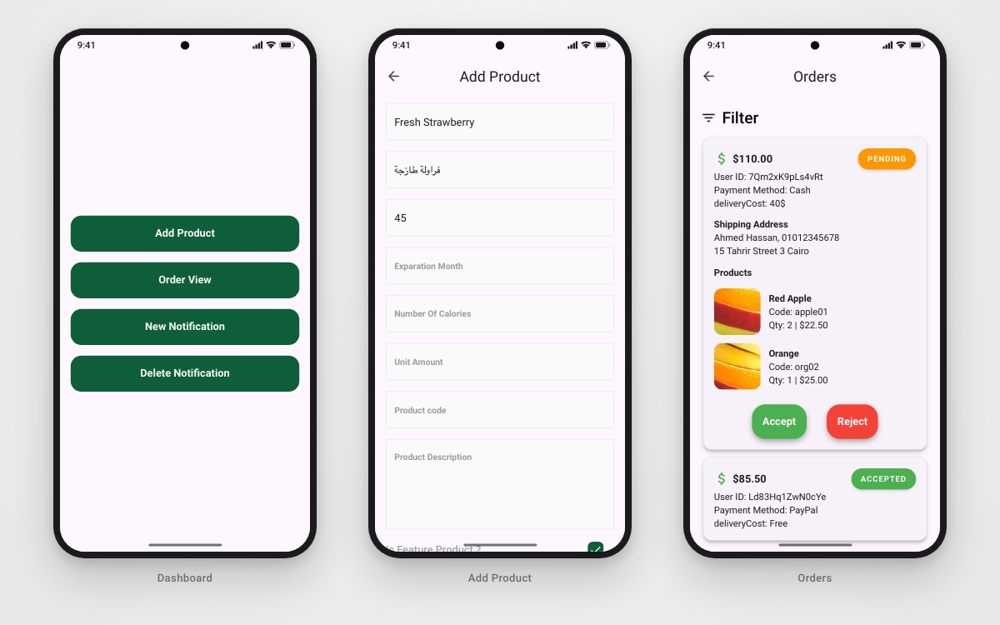

<h1 align="center">🍎 Fruits Hub — Admin Dashboard</h1>

<p align="center">
  <b>The admin side of the Fruits Hub marketplace.</b><br/>
  Add products, follow orders live, update their status and publish coupon notifications — all on Firebase + Supabase.
</p>

<p align="center">
  
  
  
  
  
  
</p>

<p align="center">
  
  <br/><sub>Dashboard · Add product · Orders</sub>
</p>

---

## 📖 About

Fruits Hub is a marketplace system made of a **[customer mobile app](https://github.com/youssef336/Fruits_Hub)** and this **admin dashboard**, built to manage products, orders and users with live updates.

The project focuses on scalability, clean architecture and real-world business logic, simulating a complete e-commerce workflow — from a customer placing an order to the admin accepting and delivering it.

## 🚀 Project overview

- **Customer app** — browse products, place orders, receive offers.
- **Admin dashboard (this repo)** — manage products, orders and notifications.
- **Backend** — Firebase Authentication and Cloud Firestore shared by both apps; product and notification images stored in Supabase Storage.

The project was built end-to-end, from system design to implementation and testing with real users.

## ✨ Key features

### 🖥 Admin dashboard (this repo)
- 🔐 **Admin login** with Firebase Auth
- ➕ **Add products** — English & Arabic names, description, price, code, unit amount, calories, expiry months, organic / featured flags, and a product image picked with `image_picker` and uploaded to **Supabase Storage**
- 📦 **Live orders** — orders streamed from Firestore (`snapshots()`), also sortable by date
- 🔄 **Order status** — move an order between `pending`, `accepted`, `delivered` and `canceled`
- 🔔 **Notifications** — publish offers with an image and a coupon code, and delete old ones
- ⏳ Skeleton loading (`skeletonizer`) and progress overlays (`modal_progress_hud_nsn`)

### 📱 Customer app ([Fruits_Hub](https://github.com/youssef336/Fruits_Hub))
- Email, Google and Facebook sign-in
- Products, best sellers, cart and favourites
- Checkout with cash on delivery or PayPal
- Coupon notifications, English / Arabic

## 🧱 Architecture & approach

- **Feature-first Clean Architecture** — every feature has `data`, `domain` and `presentation` layers
- **State management** with `bloc` / `flutter_bloc` (Cubits per use case: login, add product, fetch / update orders, notifications)
- **Swappable services** — `AuthService`, `DatabaseService` and `StorageService` abstractions with Firebase, Firestore and Supabase / Firebase Storage implementations, wired with `get_it`
- **Functional error handling** — `Either<Failure, T>` from `dartz`
- Designed to support future features such as payments, analytics and role expansion

## 🛠 Tech stack

| Concern | Choice |
|---|---|
| UI | Flutter (Dart), `skeletonizer`, `modal_progress_hud_nsn` |
| State | `bloc`, `flutter_bloc` |
| DI / errors | `get_it`, `dartz` |
| Backend | Firebase Auth, Cloud Firestore |
| File storage | Supabase Storage (`supabase_flutter`); Firebase Storage implementation also included |
| Utilities | `image_picker`, `uuid`, `intl`, `path` |
| Version control | Git & GitHub |

## 🏗 Project structure

```
lib/
├── core/
│   ├── services/        # Firebase auth, Firestore, Supabase & Firebase storage, get_it
│   ├── repos/           # product_repo, product_image_repo, notification_image_repo
│   ├── enums/           # OrderEnum
│   └── widgets/ utils/ helper_functions/ errors/ usecases/
└── feature/
    ├── auth/            # admin login
    ├── home/            # dashboard home
    ├── add_product/
    ├── orders/          # live orders + status updates
    ├── notification/    # publish offers
    └── delete_notification.dart/   # remove offers
```

## 📦 Repositories

| | |
|---|---|
| 📱 Customer app | [github.com/youssef336/Fruits_Hub](https://github.com/youssef336/Fruits_Hub) |
| 🖥 Admin dashboard | [github.com/youssef336/fruits_hub_dashboard](https://github.com/youssef336/fruits_hub_dashboard) |

## 🧪 Production-like experience

The system was put in front of real users for testing, and iterated on through:
- feature changes
- UI improvements
- bug fixes based on feedback

It was built with a business-driven mindset — the goal was a complete product, not isolated screens.

## 🚀 Getting started

**Prerequisites:** Flutter SDK (Dart `^3.7`), a Firebase project and a Supabase project.

```bash
git clone https://github.com/youssef336/fruits_hub_dashboard.git
cd fruits_hub_dashboard
flutter pub get
flutter run
```

**Configuration**
1. **Firebase** — run `flutterfire configure` and use the same project as the customer app.
2. **Supabase** — create a storage bucket and set `KsupabaseURL`, `KsupabaseAnonKey` and `KsupabaseBucket` in `lib/constant.dart` to your own values.
3. Create an admin user in Firebase Auth to sign in.

## 📌 Why this project matters

This project demonstrates the ability to:
- build complete systems, not just UI screens
- handle live data and real business logic (orders, status flow, notifications)
- combine several backends (Firebase + Supabase) behind clean abstractions
- think like a mobile developer in a real company environment

## 👤 Author

**Youssef Belal Zakaria** · [GitHub @youssef336](https://github.com/youssef336)
Mobile (Flutter) Developer · [Portfolio](https://youssef-apps.netlify.app) · [LinkedIn](https://linkedin.com/in/youssef-belal-509385294)

⭐ If you like this project, give it a star!
